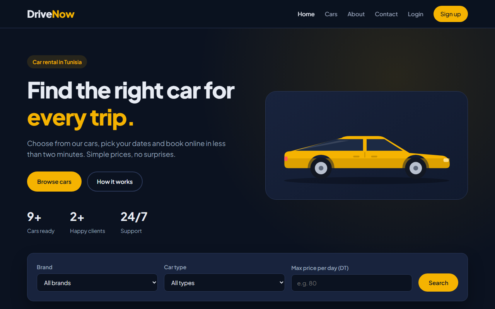
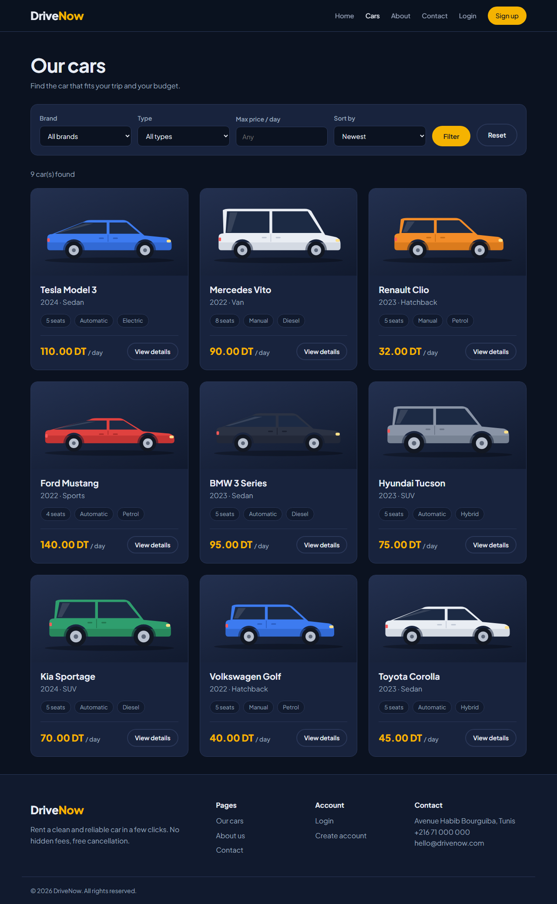
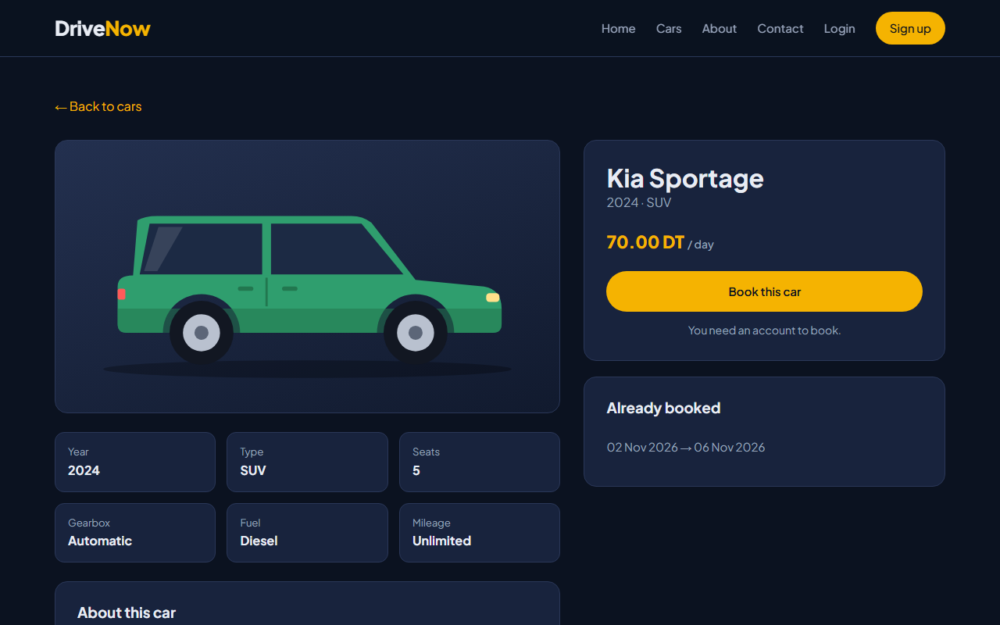
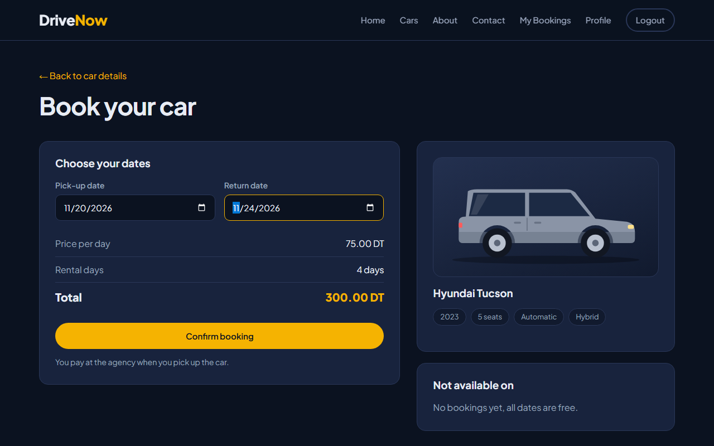
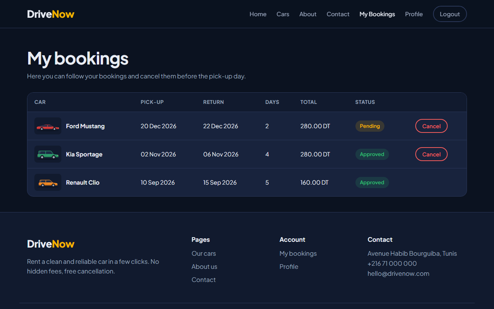
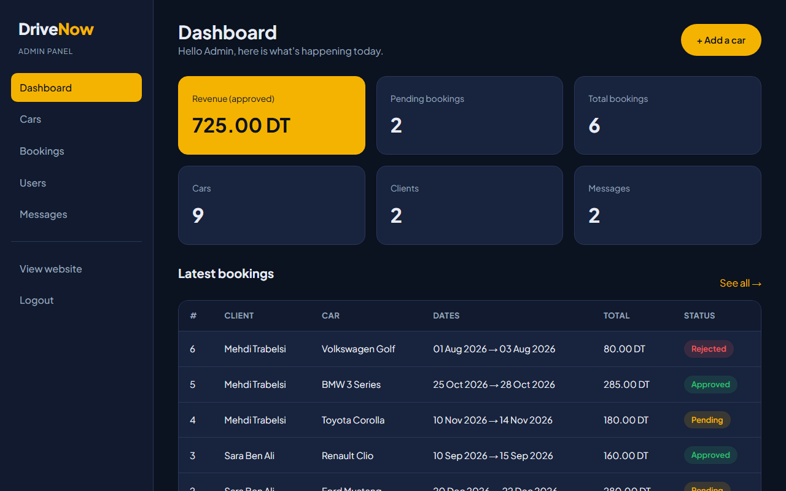
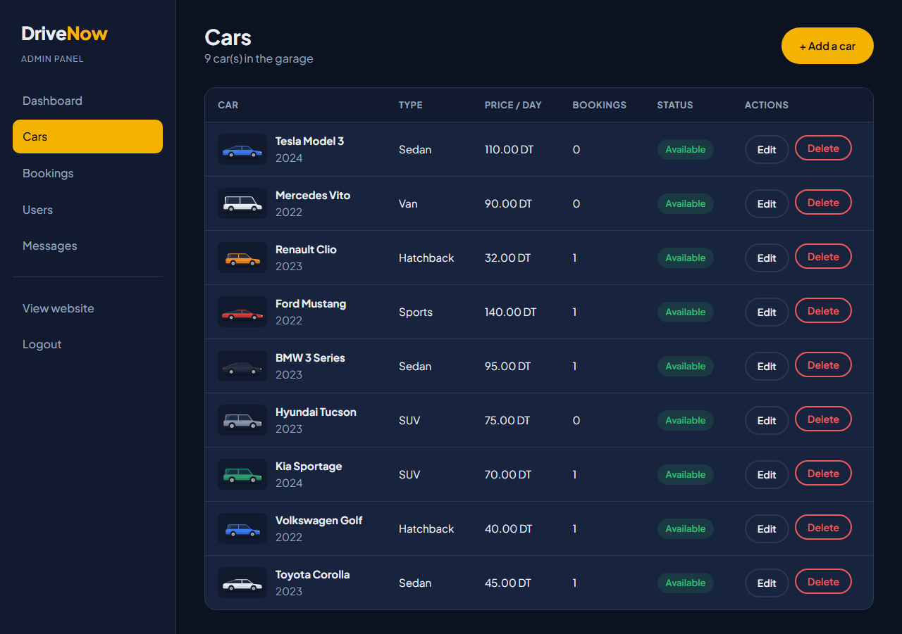
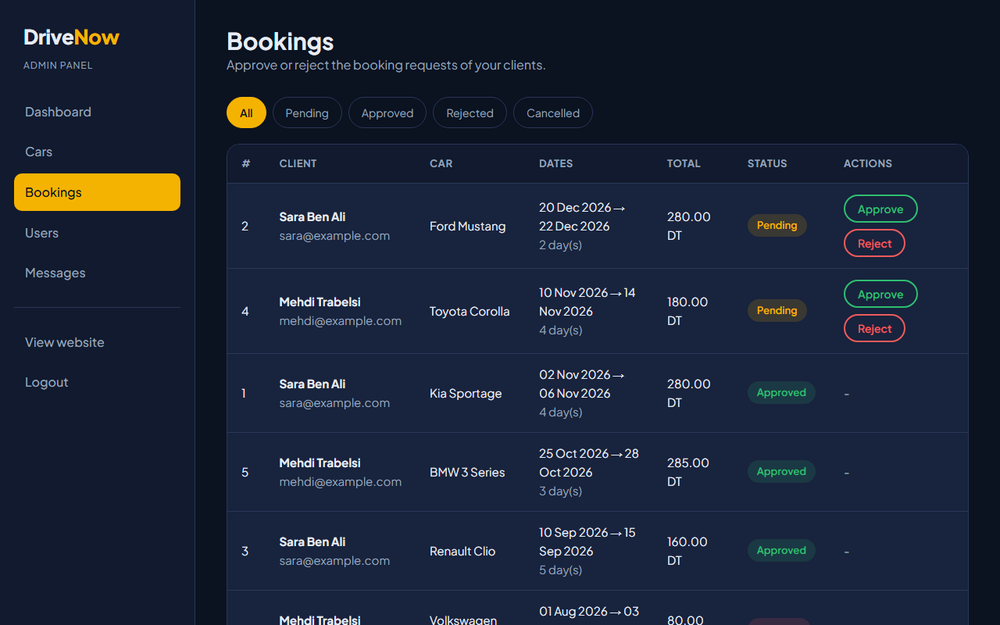

# DriveNow - Vehicle Booking System

DriveNow is a car rental website I built with **plain PHP and MySQL**. Visitors can browse cars, filter them, and book a car for specific dates. The admin manages the cars, accepts or rejects bookings, and reads the messages sent from the contact page.

I made this project to practice PHP sessions, forms, file uploads and SQL with prepared statements, without using any framework.



## Features

### Visitors
- Home page with a search form and the latest cars
- Cars page with filters (brand, type, max price) and sorting by price
- Car details page showing the dates where the car is already booked
- About page and a contact form (messages are saved in the database)

### Clients
- Register, login and logout (passwords are hashed with `password_hash`)
- Book a car by choosing a pick-up and a return date
- The total price is calculated live with JavaScript and checked again in PHP
- A car can't be booked twice for the same dates
- "My bookings" page with the status of each booking
- Cancel a booking before the pick-up day
- Profile page to update the name, the phone number and the password

### Admin
- Dashboard with revenue, the number of pending bookings, cars, clients and messages
- Add, edit and delete cars, with image upload (JPG, PNG or WEBP, max 2 MB)
- Mark a car as unavailable (for example during maintenance)
- Approve or reject bookings, with a filter by status
- List of users with their number of bookings and the money they spent
- Read and delete contact messages

## Tech stack

- **PHP 8** (procedural, no framework)
- **MySQL / MariaDB** with `mysqli` prepared statements
- **HTML5 and CSS3** (my own stylesheet with flexbox and grid, no Bootstrap)
- **Vanilla JavaScript** for the mobile menu, the price calculation and the confirm popups
- Google Font: Plus Jakarta Sans

## Screenshots

| Cars list | Car details |
|---|---|
|  |  |

| Booking | My bookings |
|---|---|
|  |  |

| Admin dashboard | Admin cars |
|---|---|
|  |  |

| Admin bookings |
|---|
|  |

## Installation

1. **Clone the project**
   ```bash
   git clone https://github.com/sirine2907/vehicle-booking-system.git
   cd vehicle-booking-system
   ```

2. **Create the database.** Import `database/schema.sql` with phpMyAdmin, or run:
   ```bash
   mysql -u root -p < database/schema.sql
   ```
   This creates the `drivenow` database with the tables and some sample data.

3. **Check the database settings** in `includes/db.php`:
   ```php
   $db_host = "localhost";
   $db_user = "root";
   $db_pass = "";
   $db_name = "drivenow";
   ```

4. **Enable the `mysqli` extension** in your `php.ini` if it is not already enabled (`extension=mysqli`).

5. **Run the project**
   - With the PHP built-in server:
     ```bash
     php -S localhost:8000
     ```
     Then open http://localhost:8000
   - Or put the folder in `htdocs` (XAMPP) and open http://localhost/vehicle-booking-system

> The `uploads/cars/` folder must be writable so the admin can upload car images.

## Demo accounts

| Role | Email | Password |
|---|---|---|
| Admin | admin@drivenow.com | admin123 |
| Client | sara@example.com | user123 |

The admin panel is at `/admin`. You can also log in with the admin account from the normal login page, and you will be redirected there.

## Folder structure

```
vehicle-booking-system/
├── admin/
│   ├── includes/
│   │   ├── admin-header.php   # sidebar + admin check
│   │   └── admin-footer.php
│   ├── index.php              # dashboard
│   ├── cars.php               # list and delete cars
│   ├── car-form.php           # add / edit a car
│   ├── bookings.php           # approve / reject bookings
│   ├── users.php
│   └── messages.php
├── includes/
│   ├── db.php                 # database connection
│   ├── functions.php          # helper functions (session, messages...)
│   ├── header.php
│   ├── footer.php
│   └── car-card.php           # car card used on several pages
├── css/style.css
├── js/main.js
├── images/cars/               # default car images (svg)
├── uploads/cars/              # images uploaded by the admin
├── database/schema.sql
├── screenshots/
├── index.php                  # home page
├── cars.php                   # all cars + filters
├── car.php                    # car details
├── book.php                   # booking form
├── my-bookings.php
├── cancel-booking.php
├── profile.php
├── register.php
├── login.php
├── logout.php
├── about.php
└── contact.php
```

## Database

| Table | Description |
|---|---|
| `users` | clients and admins (`role` column) |
| `cars` | all the cars with their price per day and image |
| `bookings` | who booked which car, the dates, the total price and the status (`pending`, `approved`, `rejected`, `cancelled`) |
| `messages` | messages sent from the contact page |

## What I learned

- How to use sessions to keep a user logged in and protect pages
- How to use prepared statements to avoid SQL injection
- How to check if two date ranges overlap in SQL
- How to upload and validate image files safely
- How to build a responsive layout with CSS grid and flexbox, without a framework

## Ideas for later

- Send an email when a booking is approved
- Online payment
- A calendar view of the bookings for each car
- Pagination on the cars page

## Author

**Sirine Ayadi** - [GitHub](https://github.com/sirine2907)
